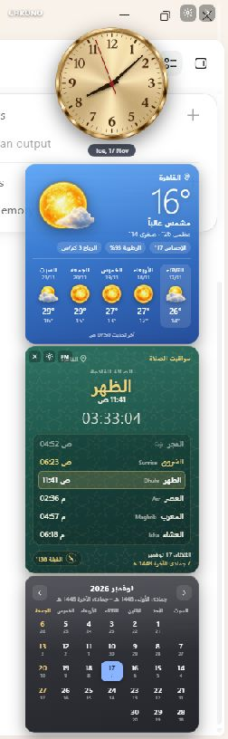

# Chrono 1.3

Desktop widget bar for Windows: weather, analog and digital clocks, calendar, calculator, world time, sticky notes and prayer times. English / Arabic per widget.

**[⬇ Download the latest Chrono installer](https://github.com/ahmadelhendawy1/chrono/releases/latest)** · [All releases](https://github.com/ahmadelhendawy1/chrono/releases)

## Screenshots

| Light | Dark | Glass |
|:---:|:---:|:---:|
|  |  |  |
| **Classroom clock face** | **Digital clock + world time** | |
|  |  | |

## Install
Download **Chrono-Setup-x.y.z.exe** from the [latest release](https://github.com/ahmadelhendawy1/chrono/releases/latest) and double-click it (English / Arabic installer, no admin rights needed).
Windows may show a SmartScreen warning because the installer is not code-signed: click **More info → Run anyway**.

## Use
- **Pin button (new in 1.3):** the pin at the top of the sidebar keeps Chrono on screen (pinned, the default). Unpin it and Chrono hides by itself, then slides back out when you push the mouse to the right edge of the screen (or left, if you choose). The sidebar sits flush against the screen edge with no gap.
- **Widget switches (new in 1.3):** the grid button at the top of the sidebar opens an on/off switch for every widget, so a widget you closed with its X comes back with one click. The same switches are in the tray menu.
- Chrono lives in the system tray. Left-click pops the widgets out / hides them; right-click opens the menu (widget switches, layout, lock, always-on-top, start with Windows, settings).
- Ctrl + mouse wheel over a widget resizes it. Settings > Widgets has a size slider per widget.
- Each widget has its own ع / EN switch (hover the widget), or Settings > General > "Language for each widget".
- Settings and notes are saved in `%APPDATA%\Chrono`.

## Build
```
npm install
npm test
npm run package:win
npm run installer:win
```
