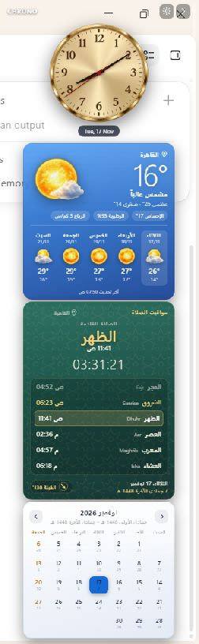
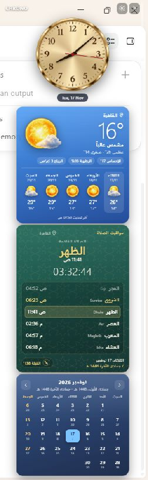
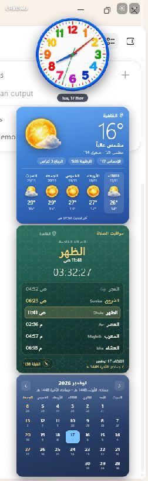

# Chrono 1.4

Desktop widget bar for Windows: weather, analog and digital clocks, calendar, alarm clock, calculator, world time, sticky notes and prayer times. English / Arabic per widget.

**[⬇ Download the latest Chrono installer](https://github.com/ahmadelhendawy1/chrono/releases/latest)** · [All releases](https://github.com/ahmadelhendawy1/chrono/releases)

## Screenshots

| Light | Dark | Glass |
|:---:|:---:|:---:|
|  |  |  |
| **Classroom clock face** | **Digital clock + world time** | |
|  |  | |

## Install
Download **Chrono-Setup-x.y.z.exe** from the [latest release](https://github.com/ahmadelhendawy1/chrono/releases/latest) and double-click it (English / Arabic installer, no admin rights needed).
Windows may show a SmartScreen warning because the installer is not code-signed: click **More info → Run anyway**.

## Use
- **Windows 7 style sidebar (new in 1.4.3):** every widget in the sidebar shares one width and lines up flush to the screen edge. Pick Small / Medium / Large with the S·M·L button in the sidebar header (or Ctrl + wheel over the sidebar). When you add widgets and they no longer fit the screen height, the whole column shrinks evenly; remove some and it grows back. The sidebar window hugs the column, so the desktop beside it stays clickable.
- **Pop a widget out (new in 1.4.1):** every widget in the sidebar has a pop-out button: that one widget floats on the desktop while the others stay in the sidebar, which closes the gap. The dock button on the floating widget puts it back.
- **Resize floating widgets (new in 1.4.1):** drag the grip in the bottom-right corner outward or inward, or scroll the mouse wheel over it (Ctrl + wheel anywhere on the widget works too).
- **Alarm clock (new in 1.4):** phone-style alarms with repeat days, a label, built-in tones or your own music file, rising volume and snooze. When an alarm goes off, a banner pops up above the clock in the taskbar (Stop / Snooze) and a Windows notification appears. Alarms ring as long as Chrono is running, even when the widget is hidden.
- **Floating sticky notes (new in 1.4):** Windows 7 style notes that live on the desktop: resizable, 6 colours (right-click), + for a new note, × to delete, a pin to keep one on top, and Ctrl+B / I / U / T formatting. Create one from the tray menu or the notes widget.
- **Calculator (new in 1.4):** memory keys (MC MR M+ M− MS), a history of every calculation, and an **Items × Price** tab for shopping lists or invoices (quantity × price per line, running total, copy, save to history).
- **Pin button (new in 1.3):** the pin at the top of the sidebar keeps Chrono on screen (pinned, the default). Unpin it and Chrono hides by itself, then slides back out when you push the mouse to the right edge of the screen (or left, if you choose). The sidebar sits flush against the screen edge with no gap.
- **Widget switches (new in 1.3):** the grid button at the top of the sidebar opens an on/off switch for every widget, so a widget you closed with its X comes back with one click. The same switches are in the tray menu.
- Chrono lives in the system tray. Left-click pops the widgets out / hides them; right-click opens the menu (widget switches, layout, lock, always-on-top, start with Windows, settings).
- Ctrl + mouse wheel over a widget resizes it; floating widgets also have a corner grip. Settings > Widgets has a size slider per widget.
- Each widget has its own ع / EN switch (hover the widget), or Settings > General > "Language for each widget".
- Settings and notes are saved in `%APPDATA%\Chrono`.

## Build
```
npm install
npm test
npm run package:win
npm run installer:win
```
