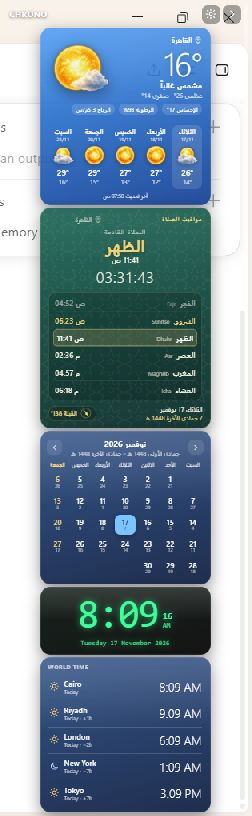

# Chrono 1.2

Desktop widget bar for Windows: weather, analog and digital clocks, calendar, calculator, world time, sticky notes and prayer times. English / Arabic per widget.

**[⬇ Download Chrono-Setup-1.2.0.exe](https://github.com/ahmadelhendawy1/chrono/releases/download/v1.2.0/Chrono-Setup-1.2.0.exe)** · [All releases](https://github.com/ahmadelhendawy1/chrono/releases)

## Screenshots

| Light | Dark | Glass |
|:---:|:---:|:---:|
|  |  |  |
| **Classroom clock face** | **Digital clock + world time** | |
|  |  | |

## Install
Download **Chrono-Setup-1.2.0.exe** from the [latest release](https://github.com/ahmadelhendawy1/chrono/releases/latest) and double-click it (English / Arabic installer, no admin rights needed).
Windows may show a SmartScreen warning because the installer is not code-signed: click **More info → Run anyway**.

## Use
- Chrono lives in the system tray. Left-click shows/hides all widgets; right-click opens the menu (widgets, layout, lock, always-on-top, start with Windows, settings).
- Ctrl + mouse wheel over a widget resizes it. Settings > Widgets has a size slider per widget.
- Each widget has its own ع / EN switch (hover the widget), or Settings > General > "Language for each widget".
- Settings and notes are saved in `%APPDATA%\Chrono`.

## Build
```
npm install
npm test
npm run package:win
npm run installer:win
```
